# The State Map's pieces as low-poly figures

The battle map's bodies became low-poly figures (`survivor-sprites-3d.md`). This brings the State Map's moving
pieces to the same look: everything that walks, drives, rows or shambles across the hex map is now built from the
same primitive, in the same 2:1 projection, under the same light, and it moves. The places (bases, sites, camps,
markers) keep their flat painters in `ui/mapsprites.js`.

## What changed

- **One renderer for the pieces** (`ui/mapfigures.js`): a person 14 px tall built from `ui/figures.js`'s limb (a
  tapered prism between two points, lit by its normals), with a head that gets a rim, legs and arms that swing, hats
  (helmet, hood, cap, straw, mohawk), a pack, a sack, a big load with a bedroll, a robe, and what the hands do (a rifle
  low ready, a raised blade, a spear, a fork, a torch, a banner, a shield, binoculars, a stick, a crowbar, an axe, a
  rod, a basket, buckets, a lantern). Vehicles are boxes on eight-sided wheels: the pickup (and its bed loads: a tarp,
  crates and a pennant, drums), the sedan, the Army truck under its canvas, the Humvee and the MRAP with a ring gun,
  the raiders' caged and spiked pickup, the armoured truck, the covered wagon behind its mules or oxen, the tractor, the
  zealots' shrine cart, handcarts, a rowboat with two rowers, a log raft with the car on it and a poler, a bicycle and a
  motorbike with their riders. Animals (mule, ox, deer, hog) are a body on four trotting legs with a neck and a head.
- **A piece is a small scene**: the people of a party in a loose column along the way they go, a convoy's vehicle, a
  raid's Humvee behind the people on foot, the traders' mule with the walkers, the merchants' wagon between its oxen
  and its escort, a horde's dead spread in a crowd each a little off the others' heading and step, a herd grazing.
  Every figure and every part (a cab, a wheel, a load, a weapon) gets a dark rim where it meets another, so the pieces
  in a crowd stay apart at the map's 1×.
- **It turns with its road.** A piece has a heading: the yaw whose forward projects along the way it travels on the
  screen (`yawOf`), cached every 15°. The six ways a road leaves a hex are six headings; a glide between tiles, a
  boat's crossing and a worker's path give any other. No more mirroring: a team walking up the screen shows its
  backs, one coming down shows its faces. Whatever one hand holds goes in the hand nearer the viewer, so a rifle or a
  torch shows at every heading. Standing still, a piece keeps the way it last moved.
- **It moves.** Frame 0 stands; frames 1–8 are one cycle: a walk's two steps (legs and arms swinging, the body riding
  up and down, a limp's short step on the bandaged leg, a heavy load's bent back), a wheel's turn (its flats and three
  spokes going round), the oxen's and the mule's trot, the oars pulling, the raft's poler leaning into the push, the
  cranks of a bicycle going round, the dead shuffling with their arms out. `render.js` picks the frame from the clock
  in step with the old bob (`cycleFrame`, a step 380 ms, a wheel 240 ms, a cart 520 ms) only while the piece is on
  its way; animations off hold a stride.
- **The light pushed harder** than the battle figures' (`MAP_LIGHT`): at a dozen pixels across, a box's faces must
  part at a glance, so the top is well lit and a face turned to the screen's right is deep in shade. `figures.js`
  takes the rule from the transform (`W.light`), so the battle view keeps its own.

The painters: `mapPartyCanvas` (your teams by kind, with a vehicle's upgrades), `mapSoloCanvas` and
`mapCyclistCanvas` (a team of one, with a carried light and a gait), `mapGroupPartyCanvas` and `mapGroupSoloCanvas`
(the groups' parties by type and kind: the bands and the nomads too), `mapOutsiderPartyCanvas` and
`mapOutsiderSoloCanvas`, `mapHordeCanvas`, `mapHerdCanvas`, `mapWorkerCanvas` (your bases' people out on job trips in
the job's kit, home with the load). Each paints on a fixed grid per kind (so a turning piece keeps its drawn width)
with the world origin at a known point; `drawPiece` draws a canvas with that ground point where the renderer puts the
party's feet, and `pieceBox` says what it covers (the names and badges keep clear of it).

## The sheets

Your teams at the six ways a road leaves a hex, mid-stride, today's flat sprite first:

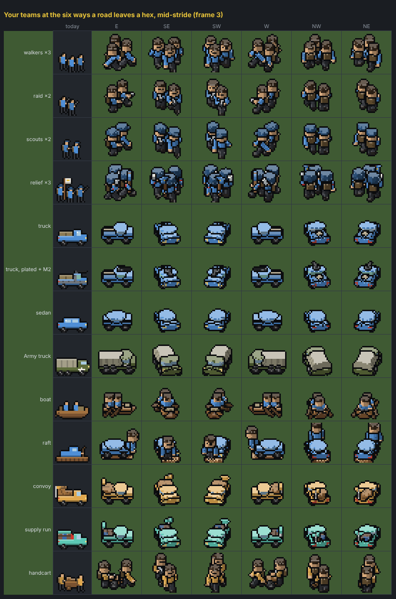

A team of one: the walk cycle by heading and gait, a torch and a lamp at night; a rider on a bike:

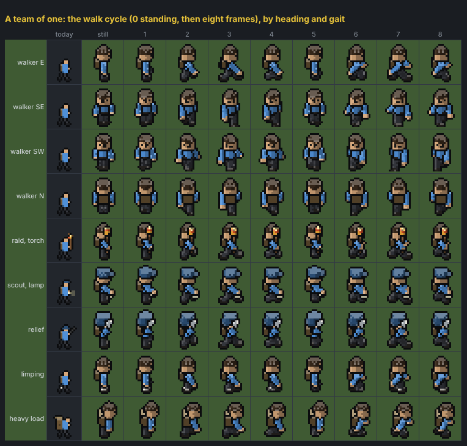

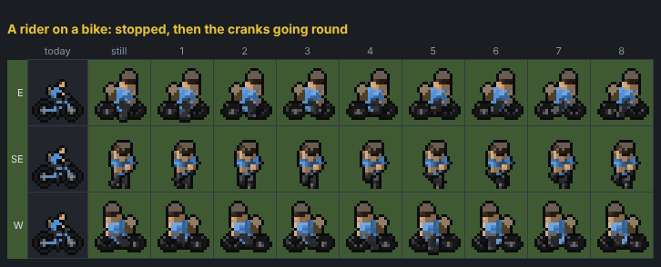

The groups' parties by type, their vehicle, a raid, scavengers, a convoy on foot, a party of one:

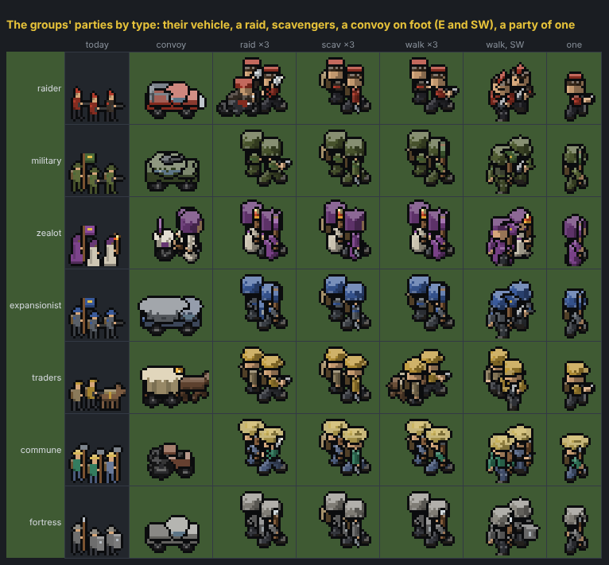

Outsiders, hordes and herds, workers out and home with the load:

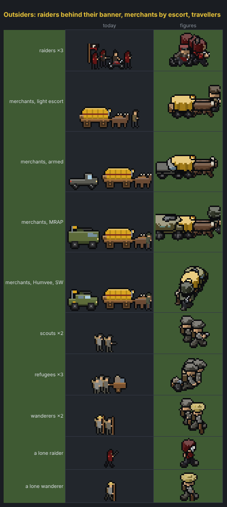

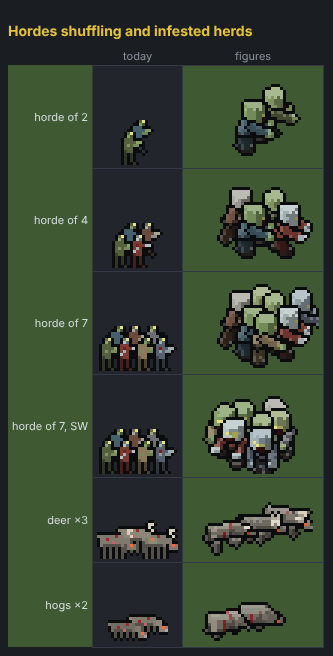

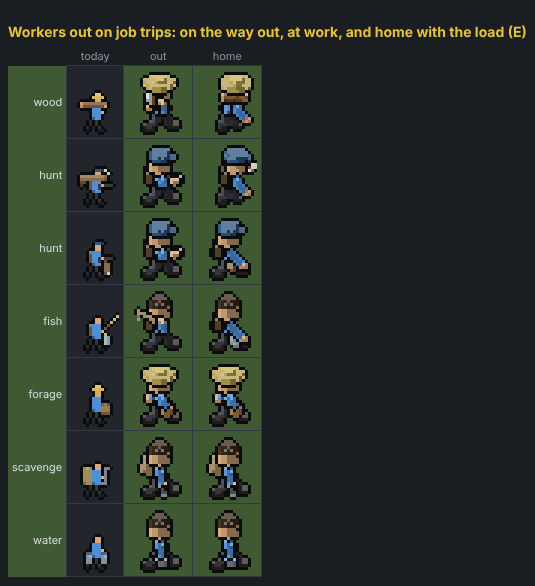

A pickup and a walker turning through the twenty-four cached headings, at 3× and at the map's 1× and 2×:

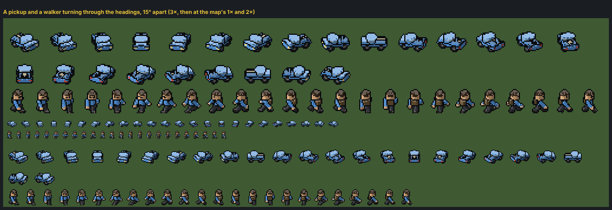

In the game (`tools/mapshot.cjs`: three teams out from the hub, a horde, a herd, merchants and raiders beside it,
the map revealed), at the map's 1×, 2× and 3×:

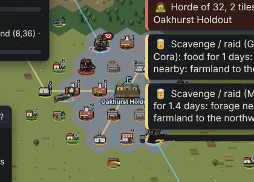

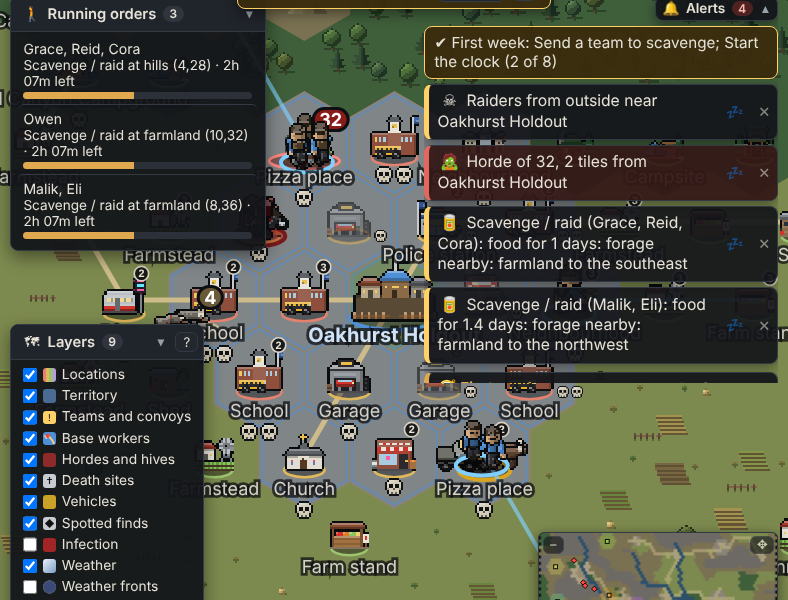

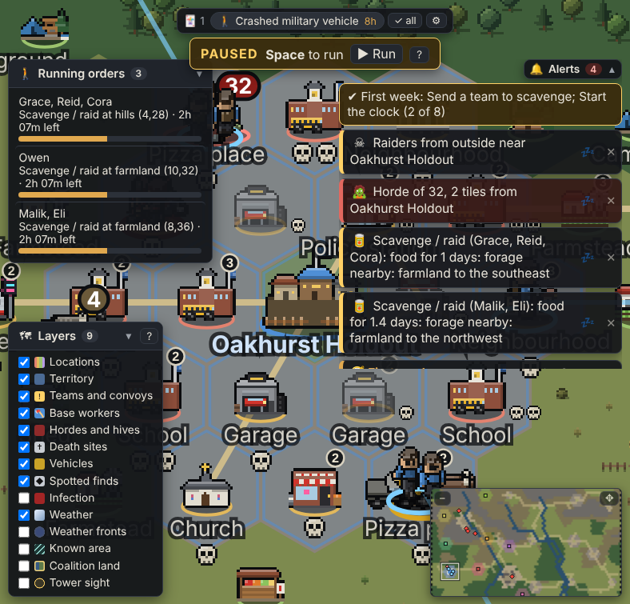

## Tools and tests

- `tools/mapfigures.html` lays out every piece (`?scale=6&only=teams` for one section, bigger);
  `tools/spritemockshot.cjs mapfigures.html docs/design-doc/sprites/map-3d` saves the sheets.
- `tools/mapshot.cjs [outdir]` begins a run in headless Chromium, sends teams out and saves the hub's neighbourhood.
- `node tools/mapfigurestest.js`: the heading maths, every piece built headless (pixels painted, no NaN, the grid fixed
  by kind, the frames and headings apart, the cache), `drawPiece`'s placement, and a frame of the renderer with a team
  on the road and a horde drawn as pieces.

## Not done here

- The Wallbreaker at a horde's head keeps its flat map sprite (`ui/hivesprites.js`), as do the hives, the places and
  the markers.
- The hex ground is drawn flat while the pieces stand in the battle map's 2:1 projection, as the flat sprites already
  did; a piece heading up or down the screen reads a little taller than one heading across.
