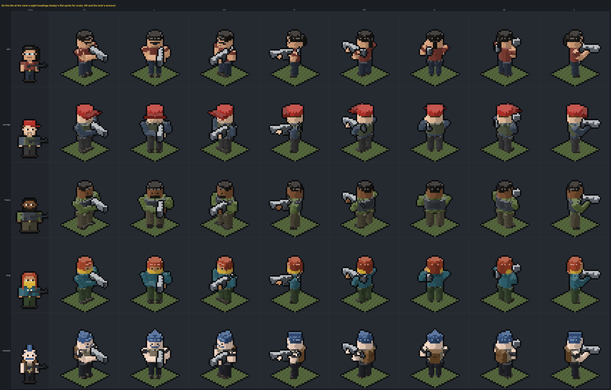
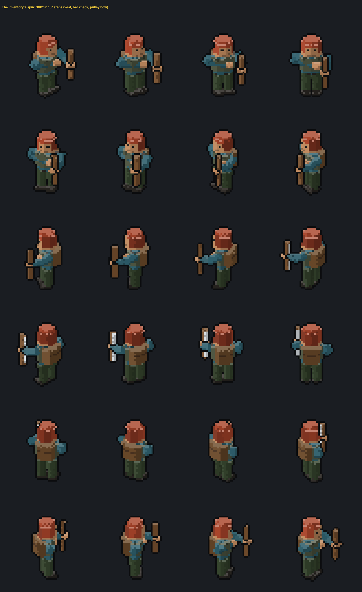
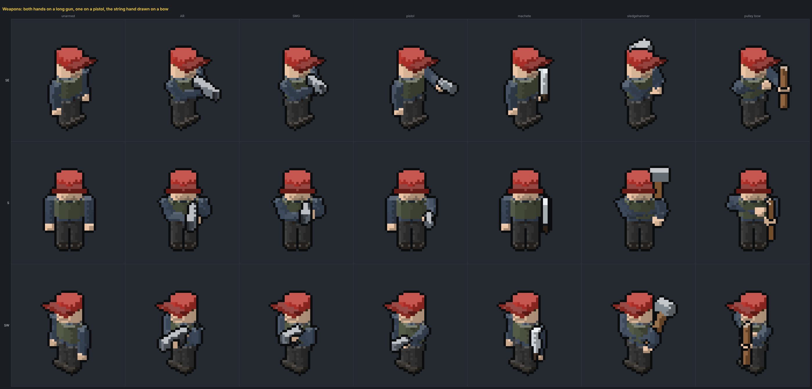
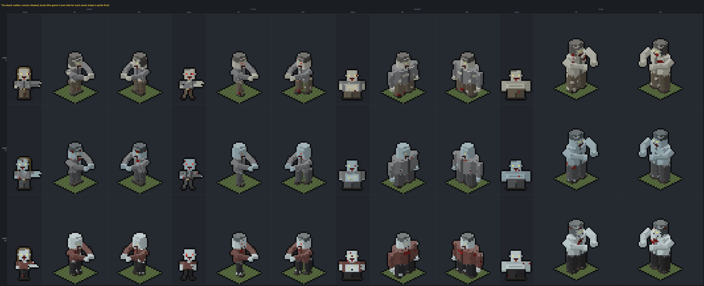
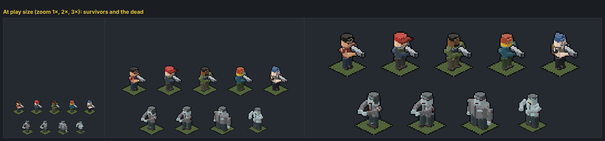
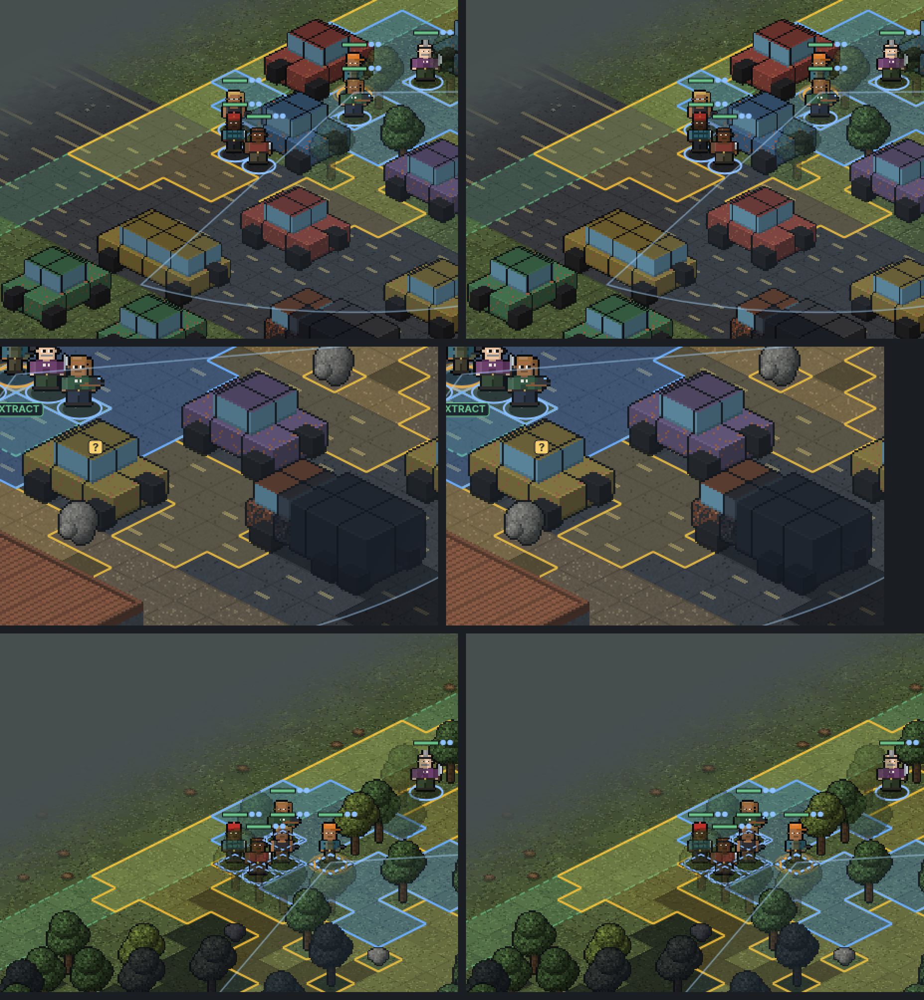
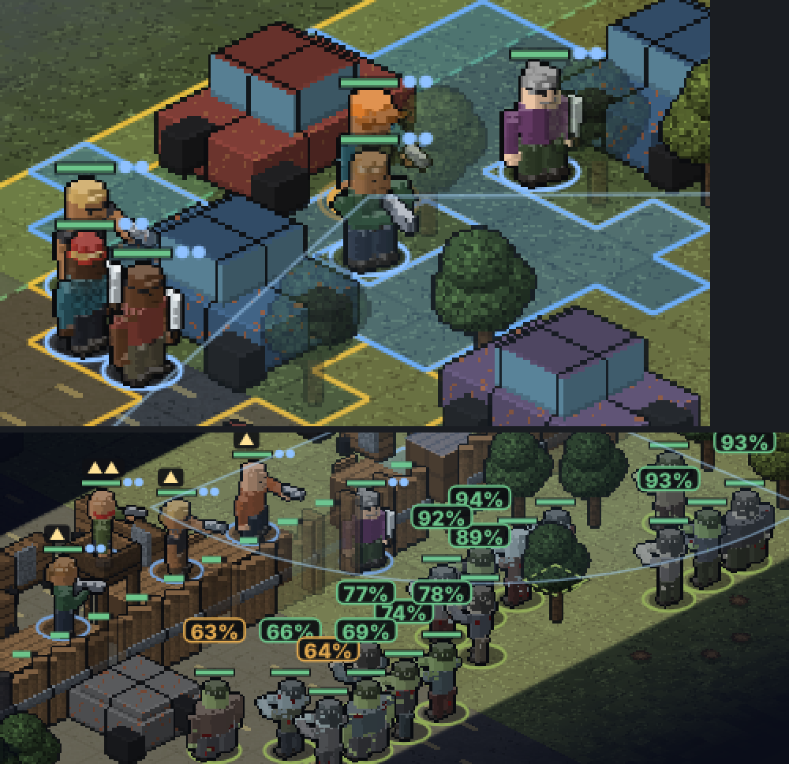
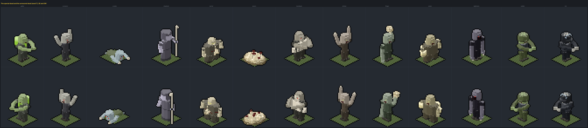
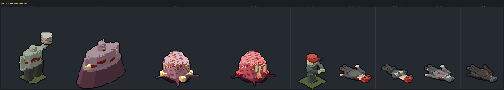
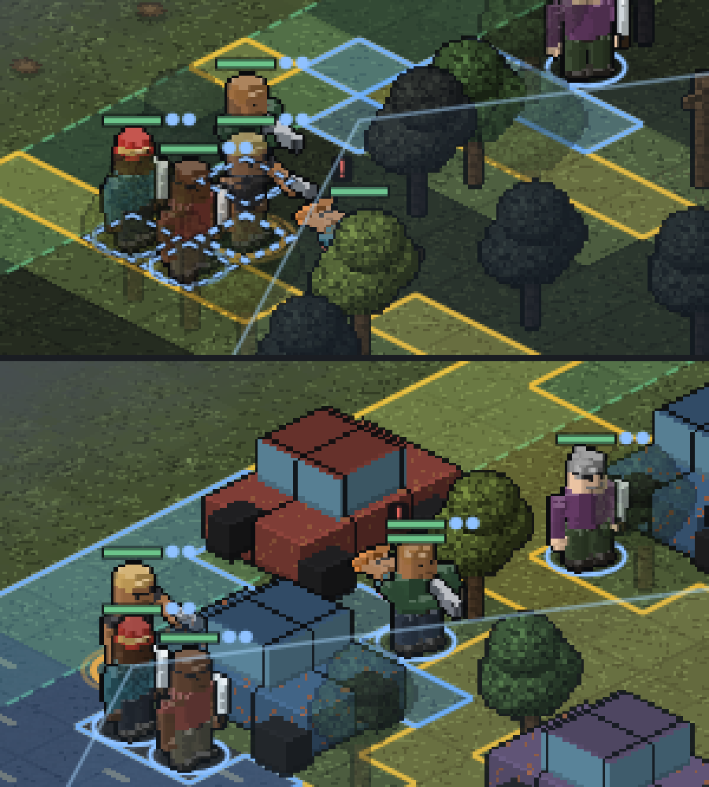

# Survivors and the dead as low-poly figures

A second direction for the character sprites, asked for after the flat-sprite brief (`survivor-sprites.md`): figures
built from 3D body parts the way Project Zomboid (and, blockier, Minecraft and Roblox) build theirs, drawn in the
battle map's own projection. A first cut used axis-aligned boxes; the owner asked for less blocky figures and arms
that hold a weapon properly in 3D, so the renderer became the one below. The pictures come from a prototype renderer that is not wired into the game
(`prototype/tools/spritebox.js`; the sheets from `tools/spritebox.html` through
`tools/spritemockshot.cjs spritebox.html`). Nothing here changes what the game draws yet.

## The idea

The battle map (`ui/isoview.js`) is already pseudo-3D: 2:1 diamonds, a tile 32 × 16 art pixels, a unit 30 pixels
tall, everything painted as pixel art and drawn nearest-neighbour, the view turning through four diagonal and four
straight headings. Today's units are the one thing in it that is flat: a side-view sprite flipped left or right.

A figure is some twenty **limbs**: the one primitive, a prism between any two 3D points with an n-sided
elliptical cross-section, tapered toward its far end. Body parts are eight-sided vertical limbs (a rounder head with
a crown, a torso narrowing to the waist, legs tapering to the ankle, feet), arms are two six-sided limbs each,
shoulder → elbow → hand, with the hand placed on the weapon's grip or fore-end; weapons are four-sided limbs (boxes)
along any direction, so a long gun lies low ready, muzzle down, along the figure's right side. Everything is in the
figure's own space, turned by a yaw, projected with the map's own formula (`screen x = x − y`,
`screen y = (x + y) / 2 − z`) and rasterised straight onto the pixel grid through a depth buffer, so an arm across
the chest or a gun through two hands sorts right per pixel at every yaw. Each face is lit by its normal with the
item art's rule (the top lit, darker the more it turns to the screen's right), which rounds the eight-sided parts;
a one-pixel dark rim is painted where a weapon meets the body and every weapon's top edge catches the light in its own
colour (a lit gunmetal, a near-white blade), so a weapon reads at a glance, at the map's 1× zoom too. It stays
procedural (the same `appearance` data: build, skin, hair style, facial hair, top style, pants, accessory, armour),
cached by look and heading, and crisp at every zoom. Faces that need a picture (eyes, a beard, a jacket's zip,
flannel, a plate on a carrier, the dead's wounds) are painted by a small texture function on the face.

## What it buys

- **It turns with the view.** Eight headings, no mirroring: the figure faces where it faces, and the view's four
  straight headings (looking down a corridor) get a straight-on figure instead of a diagonal sprite.
- **The inventory can spin it.** The same renderer at any yaw: 24 frames at 15° show everything worn and carried
  come round — the pack on the back, the vest, the bow in the hand. Drag to turn or let it idle.
- **Weapons held, in 3D.** Both hands on a long gun (right on the grip, left out to the fore-end across the
  chest), one arm out with a pistol, a bow in the fist with the string hand drawn to the chest, a sledge's haft over
  the shoulder with both fists on it, a machete down at the side. The arms reach the weapon from the shoulders at
  every heading: nothing floats.
- **One body for the living and the dead.** A zombie is the same figure with the game's own roll
  (`zombieLookOf`: palette, eyes, gore, build, cloth) reaching with both arms, torn clothes and wounds placed by the
  roll, bloated wide, the brute a third bigger, the runner mid-stride.
- **Depth for free.** A plate carrier is a limb around the torso, a pack a box behind it, a helmet a limb over the
  head; they read from every side without per-facing drawings.

## What it costs

- **The weapon art.** Today every weapon has its own drawing (116 keys) and the gun builder paints a gun's finish
  and fitted parts on the sprite. In a box figure a weapon is a box or two: an AR is a long box with a magazine box,
  a machete a thin grey box. The gun's identity stays in its thumbnail and the gun builder, not on the figure.
  Finer weapon models are possible (a few boxes each) but are a second project.
- **A different look.** Low-poly and round-shouldered where the flat sprites are drawn; the face is four pixels.
  It sits with the map's blocks and cars better than the flat sprite does, and less with the 16 × 16 item icons.
- **Soft edges at 1×.** Eight-sided parts and turned boxes rasterise as short stairs; fine at 2× and up, soft at
  the map's 1× zoom (see the play-size sheet).
- **The downed and corpse painter** (`downsprites.js`) would need the same treatment or stay flat.

## The sheets

Today's flat sprite for scale, then the figure at the view's eight headings on its tile, AR low ready in both hands.

The inventory's spin, 360° in 15° steps: vest, backpack, pulley bow.

Weapons at three headings: unarmed, AR, SMG, pistol, machete, sledgehammer, pulley bow.

The dead, three seeds of each variant, with today's sprite first.

At play size: the map's 1×, 2× and 3× zoom.

## Implementing it, if chosen

- `unitCanvas` gets a heading (the facing from `unitFacing` becomes one of eight yaws relative to the view's
  rotation) and caches by look + heading; `drawUnitSprite` stops flipping and draws the figure's canvas as it is.
- The figure painter replaces `paintSurvivor`, `paintZombie`, `paintEnemyHuman` and `paintArmoredDead`; the enemy
  kits and the armoured dead are looks for it (an armband, a hood, a helmet, a riot shell).
- Helmets, visors and the pack as limbs over the head and torso, from the `head` and `backpack` slots; the vest with
  depth from `armor`.
- A hold a weapon class with its hand points (the prototype's `figureLimbs` has them); the muzzle for tracers is the
  gun limb's far end, projected.
- The inventory and roster panels draw the figure at a chosen yaw; the inventory spins it (24 cached frames a look).
- Weapons: a box or two a class (long gun, pistol, SMG, bow, crossbow, one- and two-handed melee); the gun builder
  keeps the gun's own art for the thumbnail.
- The downed painter: lay the figure's boxes along the ground, or keep the flat corpses.

## Deciding between the two directions

The flat-sprite brief fixes what is wrong with today's sprites and keeps every weapon drawing; the low-poly figure
changes the game's character look and gets turning, spinning, depth and weapons truly in the hands. They do not
combine: a figure either is a side-view layer stack or a set of limbs. The pick is the owner's.

## The tiles, brought to the same light

The battle map's blocks (`ui/isoview.js` `prims` / `paint`) were already 3D: boxes, cylinders and blobs in tile
space with a material a face, painted per pixel. What set them apart from the figures was the light and the shading,
so that is what changed, in the game's own painter (a small, reversible change; the battle view tests pass):

- **The light rule** is the figures' and the item icons': the top lit (`1.04`, its far edges `1.16`), the south
  (screen-left) face about the colour itself (`0.92`, up from `0.8`), the east (screen-right) face well into shade
  (`0.62`). A car's lit side now reads in its paint, not a dimmed version of it.
- **Facets, not gradients.** Cylinders (trunks, barrels, hay, wells, palisade logs) shade in eight facets and blobs
  (tree crowns, boulders, rubble, hive flesh) in five bands, like the figures' eight-sided limbs; round things read
  low-poly instead of airbrushed.
- **The rim** every free-standing prop had (trees, cars, crates, barrels…) now goes round furniture, racks, lockers,
  the gun safe, tank traps, spikes, stairs, ladders, towers, bars, gates and palisades too. Walls, fences and rails
  stay un-rimmed: a rim a cell would seam their runs.

Before (left) and after (right), 1:1 crops of the town, a raid's street and the forest:

The full frame of the town, before and after: `battle-3d/before/field-town.png`, `battle-3d/after/field-town.png`
(`tools/isoshot.html` draws every test battle for real; `tools/spritemockshot.cjs isoshot.html [outdir]` saves them).

Not done here, and the next step if the figures are adopted: the props' shapes themselves. Cars are two boxes, trees
a trunk and four blobs; rounding a car's cabin or giving a tree a faceted crown needs a prism primitive in `paint()`
(the figure renderer's limb) and a pass over `prims` kind by kind.

## Wired in

The figures are the battle view's now (`ui/figures.js`, the renderer moved from the prototype into the game;
`tools/spritebox.js` re-exports it for the sheets):

- **Who is a figure.** Survivors, human enemies (raiders, soldiers with helmet and armband, zealots with hood and
  sash, from `enemyLookOf`'s rolls) and the plain dead (walkers, runners, bloated, brutes from `zombieLookOf`'s).
  The special dead, bosses, the armoured dead, the risen and the fallen keep their flat sprites: `unitFigure`
  returns null and `drawBody` falls back to `unitCanvas`.
- **The heading.** A person faces the way the game says they face (`u.face`, any angle); the dead the way of their
  last move; the old default otherwise. `unitYaw` turns it into the view's frame at every rotation, minus 45° in a
  straight view, and `figureCanvas` caches a canvas every 15° by look, weapon, armour and heading.
- **Placement.** One grid pixel is one art pixel: the canvas is drawn so the figure's feet land on the unit's feet,
  no mirroring; the sneaking squash and the spent-unit fade apply as before. `muzzlePoint` takes the gun's far end
  from the figure for tracers and flashes.
- **The inventory spin.** `figureSpinImg` replaces the flat doll in the inventory: 24 frames at 15°, one every
  110 ms, drawn once each and kept as data URLs; a ticker finds every `img[data-spin]` so the panel may be rebuilt
  at will. The roster and the other panels still show the flat side-view sprite.

In the town and at the night wall (3×):

## Every body

Asked for next: all of them. `ui/figures.js` now builds every body the battle map has from the same limbs:

- **The special dead** (`specialApp`), each from its flat painter's palette, build and pose: the Spitter (green, an
  acid sac on its back, a dripping mouth), the Screamer (gaunt, arms flung up), the Crawler (its own body: torso flat
  to the ground, head craning up, dragging itself on its arms, bone at the fingertips), the Shepherd (a shroud
  instead of legs, hooded, a long bone crook held out), the Carrier (bloated, splits in the belly, worms pushing out
  and from the mouth, a small sunk head, stubby arms), the worm swarm (a low mass of worms with raised heads, no
  body), the Boneback (plates of fused bone over the chest and the forearms, a bone mask with the eyes peering
  through), the Climber (thin, long arms up, hooked bone fingers), the Flinger (one long arm cocked back over its
  head holding a dripping mass of worms), the Sower (swollen, egg sacs hung on its back and sides), the Nightmare
  (tall, dark, long clawed arms, the jaw hanging open far wider than a jaw should); the armoured dead, a soldier in
  camo fatigues with a plate carrier and a combat helmet, a riot cop in black with a chest shell, shoulder guards and
  a riot helmet with its cracked visor pushed up. A sleeper on its feet is a walker.
- **The bosses** (`bossApp`): the Wallbreaker (half again as big, the head sunk low, ribs through the skin, a slab
  of concrete with rebar in it raised in one fist), the Broodmother (swollen, on the mound she grows from, three
  eyes, a crown of bone, egg sacs, clawed arms), the Hivemind (no body: a folded mass of lobes, veined and glowing,
  pods and tendrils at its foot, in a pool of flesh) and its second phase (redder, torn open down the middle with
  light pouring out, the pods burst).
- **The risen** (`risenApp`): the person as they were and in what they wore, gone grey-green, reaching.
- **The fallen** (`unitFigureDown`, `corpseFigure`): the same figure laid along the world's x through a second
  transform (the figure's up along +x, its front turned up and pressed flat), the head toward the way the unit
  faced, in a pool of blood when dead; down and alive with the knees drawn up and the arms over the chest. Bodies on
  the ground (sleepers' corpses) the same, burnt ones charred, burst ones split. The worm swarm and the Hivemind
  cannot lie down: dead, they go dark.
- **The panels**: `survivorURL`, `appearanceURL`, `zombieURL` and `unitCanvas` in `ui/sprites.js` now hand out the
  figure at a three-quarter heading (25°), so the roster, the family and relations views, the team panels, the
  customisation screen and the zombie-look preview all show the figures; `spriteImg` takes the figures' shape. The
  flat painters stay as fallbacks (`unitCanvasFlat`, `downsprites.js`).

In play, a survivor down beside the others and the dead among the trees (3×):

