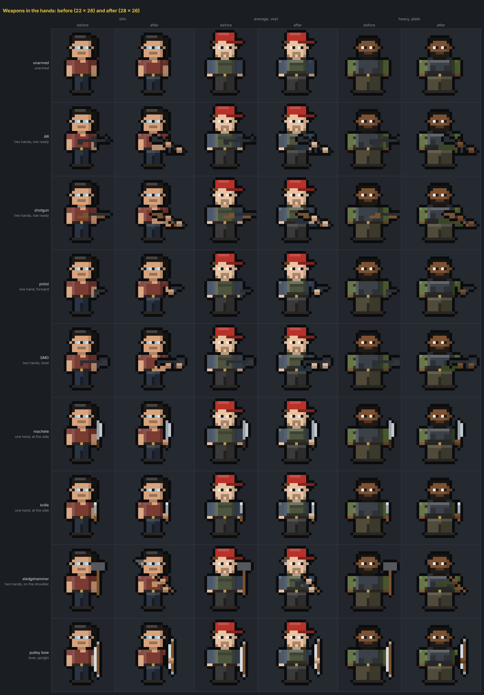
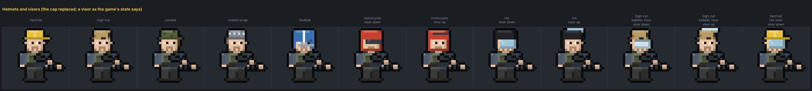
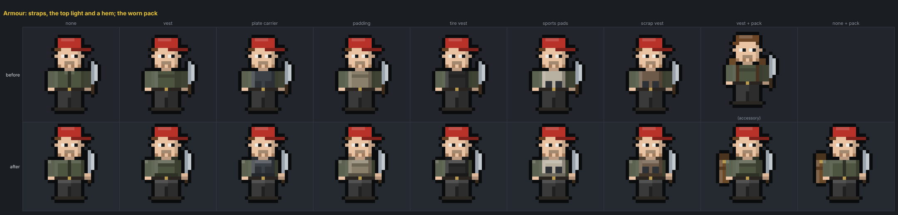

# Survivor sprites: weapons in the hands, helmets, the item art's light

A design brief for polishing the procedural survivor sprites (`prototype/src/ui/sprites.js`) so they sit with the
item and gun art, with the held weapon the first fix. Agreed in a design session on 2026-10-16; every choice below was
put to the owner and settled. The pictures come from a prototype painter that is not wired into the game
(`prototype/tools/spritemock.js`; the sheets from `tools/spritemock.html` through `tools/spritemockshot.cjs`), so
nothing here changes what the game draws yet.

## What is wrong today

- **The weapon floats.** Arms are two vertical columns at rows 11–16 with the hand at row 16. A melee weapon is
  anchored at row 15 one column outside the arm; a long gun starts at row 13 as a level bar with no arm reaching it,
  and no second hand ever touches a weapon. The weapon is the last layer painted, so a fist never overlaps a grip.
- **Long guns fall off the grid.** On a heavy build (body right edge at column 15) 30 of the 69 guns put their muzzle
  at column 22–23 of the 22-column canvas: the barrel tip is dropped and the muzzle flash starts off the sprite.
- **Two lights.** Item icons (`ui/itemart/kit.js`) use one light from the top left: highlight on the top and left
  edges, shade on the bottom and right. Bodies highlight the left column and shade the right but have no top-edge
  light (only hair does). A survivor holding a gun is lit differently from the gun.
- **Helmets never reach the sprite.** The `head` equipment slot has seven helmets plus clip-on visors and a built-in
  cage, but `spriteArmorKey` reads only `armor` and `arms`. Only the enemy soldier kit paints a helmet, hard-coded.
  The real backpack slot is likewise invisible (the "backpack" accessory is cosmetic and unrelated).
- **Armour is hard to read** against a top of the same colour: a 5-wide block under the arms with no edge of its own.

## Decisions

### Canvas: 28 × 26, the body unchanged
Three columns each side of the 22-wide body (`OX = 3`); the body layers keep their coordinates. Symmetric because the
iso view draws the canvas centred (`drawImage(cv, -w / 2, …)`) and flips it for facing: margin on one side only would
shift the body off its tile. `spriteImg`'s aspect and the iso `w = hgt * (22 / 26)` follow the new width.
A weapon may reach column 26 at most (one free for the outline); a gun wanted further forward slides back along the
hands until it fits, so a carbine sits ahead of the body and only the LMG lies over it (`fit` in the prototype).

### Hold grammar
One hold a weapon class, chosen from the kind the gun painter resolves (`norm(specOf(key).key).kind`) or a table for
melee (`TWO_HANDED`, `BOWS`, `XBOWS` in the prototype; the sprite module owns weapon drawings, the sim is untouched).

| hold | weapons | the pose |
|---|---|---|
| low ready | rifles, shotguns, MGs, the M79 and M32, crossbows | the level mini re-plotted muzzle-down at a 2:1 pixel stair, pivot the grip; the near arm down to a fist on the grip, the far forearm out from behind the receiver to a fist on the fore-end |
| level, two hands | SMGs | the near arm forward at chest height to the grip, the far forearm to the fore-end |
| one hand, forward | pistols, revolvers | the near arm forward, the pistol's grip in the fist |
| on the shoulder | AT4, RPG | as today (the tube's own mini), the fist on the grip |
| one hand, at the side | knives, the machete family, hatchet, tomahawk, kukri, hammer, batons, prybar, e-tool, cleaver, bowie, cutlass, sabre | hanging arm, the haft in the hand's column, the fist closed over the handle, blade up |
| two hands, on the shoulder | bat, spiked and nail bats, sledge, fire axe, pickaxe, spear, pipe spear, golf club, katana, broadsword | the upright drawing re-plotted leaning back 1:1 over the near shoulder; the part above the shoulder painted before the body so the head stands in front of it; both fists on the handle |
| bow, upright | pulley bow, compound bow | the near arm forward, the bow's grip in the fist, limbs above and below |

Two things make every hold read as held: the hands are painted **after** the weapon (a 2 × 2 fist over the grip,
and over the fore-end for two-handed holds), and the weapon gets a one-pixel dark **rim** wherever it lies over the
body (`toCanvas` outlines only against empty pixels, so a dark gun on a dark jacket had no edge).
`drawWeapon`'s contract stays: it returns the muzzle pixel, moved through the same re-plot, for tracers and flashes.
Unarmed survivors keep today's hanging arms.

### The top-left light
A highlight row on the crown of the head (seen on the bald), the shoulders (torso row 11), the top pixel of each
arm and the thighs (row 17), in the layers shared with the zombie painter, so the dead stand under the same light as
the living. The existing left highlight and right shade stay.

### Helmets and visors
The worn `head` item drawn over the hair, in place of a cap, beanie, bandana or headband (glasses stay, under a
visor). Each of the seven its own drawing in its icon's colours: hard hat, high-cut, combat, riveted scrap,
football (with its cage), motorcycle (full shell, smoked visor), riot (clear visor). A visor is drawn as the game's
state says (`u.visorUp`): down over the eyes, or pushed up on the brow; the cache key gains that bit.

### Armour and the pack
Straps over the shoulders (row 10, beside the neck), a lighter top row and a dark hem, so a vest reads against a top
of the same colour; the plate carrier keeps its plates. A worn pack (the `backpack` slot) is drawn behind the far
side of the body with its straps over the shoulders, replacing the cosmetic accessory when one is worn.

## Implementing it
The prototype's functions are the patch: `paintSurvivorMock` → `paintSurvivor` (and the same hands in
`paintEnemyHuman`, which shares `drawArms` / `drawWeapon` and gets the holds for free), `HAND`, `fit`, `blit`,
`HELMETS`, the straps in `drawArmor`, `drawPack`. Beyond `sprites.js`:
- `GW` 22 → 28 with the body offset; `spriteImg` and `isoview.js`'s `w = hgt * (22 / 26)` read the new ratio.
- `survivorCanvas` / `unitCanvas` pass the head item, the pack and the visor state; the cache key (`lookKey` +
  weapon + armour) takes them too.
- `tools/rostertest.js` keeps checking that every weapon draws and that bare hands, teeth and acid draw nothing;
  add a check that no weapon reaches the canvas edge on a heavy build (the prototype's smoke test does this).
- Zombie, boss and armoured-dead painters move to the wide canvas with the same offset and nothing else.

## Follow-ups, not in this brief
- A fallen survivor's weapon lying beside them (`downsprites.js` has its own painter; the weapon vanishes today).
- Proportions and on-sprite state (wounded, sick) were considered and left: the chibi read stays, state stays on the
  status icons.
