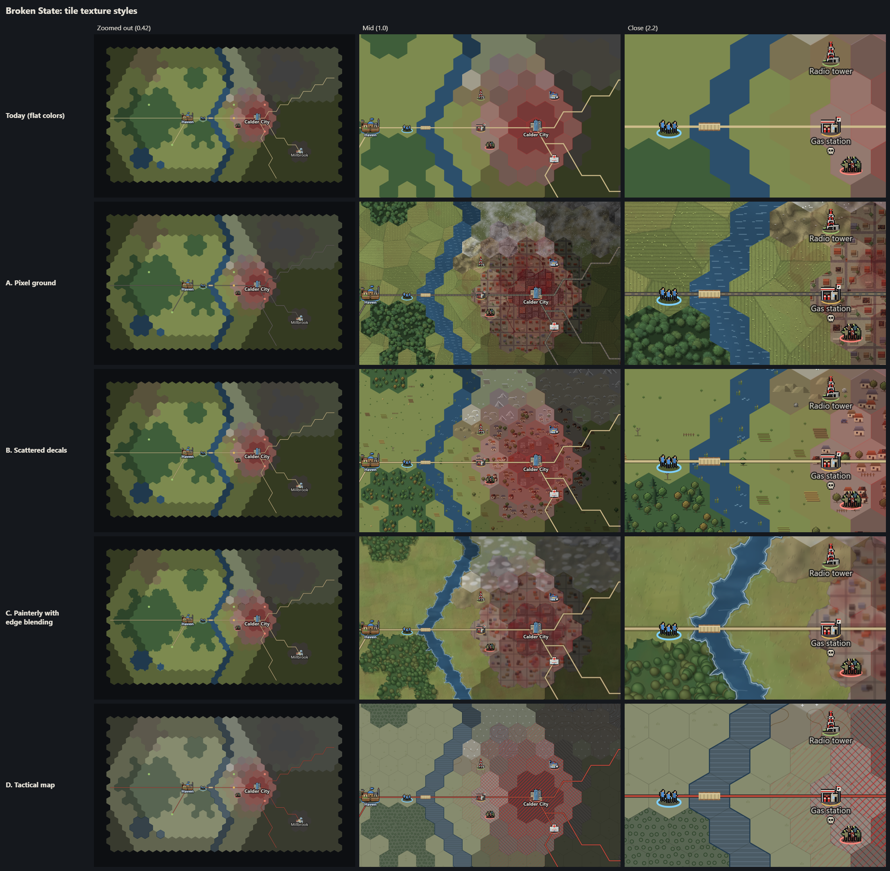

# State Map tile textures: four styles

This is a design exploration. The game is unchanged. Pick a style (or a mix) and it can be built into `render.js`.

- **Preview page:** `prototype/design/tiles.html` (module `prototype/design/tiles.js`, styles in `prototype/design/tilestyles.js`). Serve `prototype/` (for example with `node server.cjs`) and open `/design/tiles.html`. The page uses the real terrain colors (`data.js` TERRAIN), the real hex grid (`hex.js`), the real site, base, team, horde, skull and bridge sprites (`mapsprites.js`), and the real map generator for the benchmark (`mapgen.js`). **Measure on a Huge map** runs the benchmark in your browser.
- **Sample region:** every terrain type, a river with a bridge, roads, a city with suburbs, a small town, a forest edge, hills beside farmland, snow in the north-east, infection around the city, and live, reported and unknown ground around the hub (Haven). On top are sites with their plates, names and danger skulls, your hub, a team on the road and a horde of about 45.
- **Zoom levels:** zoomed out 0.42, mid 1.0 and close 2.2 (the game's maximum zoom is 2.6). The panels are drawn at 2 device pixels per CSS pixel, which is what a 4K screen at 200% scaling looks like.

| Style | Zoomed out | Mid | Close |
|---|---|---|---|
| Today (flat colors) | `0-today-far.png` | `0-today-mid.png` | `0-today-close.png` |
| A. Pixel ground | `A-pixel-far.png` | `A-pixel-mid.png` | `A-pixel-close.png` |
| B. Scattered decals | `B-decals-far.png` | `B-decals-mid.png` | `B-decals-close.png` |
| C. Painterly with edge blending | `C-painterly-far.png` | `C-painterly-mid.png` | `C-painterly-close.png` |
| D. Tactical map | `D-tactical-far.png` | `D-tactical-mid.png` | `D-tactical-close.png` |

`comparison-sheet.png` shows every style at every zoom level side by side (at half resolution).

When zoomed out (below 0.6), every style draws the flat colors you have today. C also keeps its wobbly coastlines and terrain edges, and D uses its muted palette and blue shorelines. Textures only appear from mid zoom inward.

---

## A. Pixel ground

**Look:** Every terrain gets a procedural pixel texture at 1 texel per world pixel, the same pixel size as the map's site sprites, so the ground and the icons look like one pixel-art set. Farmland is a patchwork of furrowed fields with hedgerows and patches of bare dirt. Forest is a mass of shaded tree canopies with cast shadows. Hills have relief shading with stepped contours. Mountains are cracked rock faces. Water has ripple dashes. Suburbs are streets, yards and roofs, some of them burnt out. The city is blocks of flat roofs with rubble, lane paint and cracks. Snow is a speckled cover the ground shows through, and infection is dark-red stains with veins. Textures are anchored to the world, so a forest spanning five hexes reads as one forest rather than five stickers.

**Readability:** Good at mid zoom. Up close it gets busy under icons, especially in the city: suburb roofs are about the size of a site sprite. Site plates and dark-haloed names still read clearly. Up close this style is the closest of the four to a RimWorld colony-map ground.

**Performance:** About 1.5–1.7× today's chunk cost (table below). It uses 9 textures (7 terrains, snow, infection) per zoom bucket: 2.3 / 9 / 36 MB at R = 1 / 2 / 4. Building them once takes about 0.27 s per bucket. That should happen at load, in the background, or in a worker.

## B. Scattered decals

**Look:** Today's flat colors stay. Each tile gets a few small pixel sprites on top: 5–9 trees in a forest (round trees and pines, some going autumn-gold), crop patches, tufts, fences, hay bales and the odd dead tree on farmland, mounds and rocks on hills, peaks on mountains, houses (some burnt), cars and fences in the suburbs, blocks, rubble and wrecks in the city, ripples and bank reeds on water. Every sprite has a matching snow-capped version for snowy tiles. Placement comes from a per-tile seed, so it is stable from game to game. The center of a site tile is kept clear so the decals stay out from under the site's plate.

**Readability:** The best of the textured styles for icons. Decals have no black outline and soft shadows, while game sprites keep their outlines, so sites, teams and hordes still pop. City and suburb houses do compete a little with site sprites at mid zoom. If that matters, drop decal saturation further or use fewer houses.

**Performance:** Close to today's cost up close (1.3–1.7×). Mid zoom on a whole Huge map is the most expensive case, at about 2× (roughly 5 drawImage calls per tile). Memory is tiny: one sprite atlas per bucket at 0.05 / 0.2 / 0.9 MB, plus about 650 KB of placement data per Huge world, built once at world load (about 160 ms as written, and easy to speed up). Draw the decals from one atlas pre-scaled to the bucket. The first version drew 4× sprite canvases down to size and cost 4× more.

## C. Painterly with edge blending

**Look:** Soft, brushed textures: mottled farmland with faint field patches and grass strokes, soft-lit tree canopies, smooth relief shading on hills and ridged shading on mountains, gentle streaks on water. The main feature is edge blending: each terrain bleeds a wobbly fringe into lower neighbours (mountain over forest over hills over city over suburb over farmland over water), so the hex outlines disappear and rivers and coasts get natural, ragged banks. Forests, mountains and cities cast a soft shadow on their south-east side. Every shore gets a lighter band of shallows and a line of foam.

**Readability:** Calm and low-noise under icons, which read well. The fringes break the hex shape, which looks the most natural of the four, but makes it a little harder to see exactly which hex is which (the hover and selection outline covers that). The soft city and suburb textures look a bit muddy under the infection tint.

**Performance:** The most expensive style: about 2.3–2.6× today up close and 2.2× for a whole map at mid zoom, from the fringe paths and strokes. It has the same 9 textures as A (2.3 / 9 / 36 MB) and builds fast (about 45 ms per bucket). The per-world data is a 1-byte edge mask per tile.

## D. Tactical map

**Look:** A muted, paper-map palette with ink symbols: tree rings for forest, contour lines for hills (denser, with bold index lines, for mountains), diagonal hatch for suburbs and cross-hatch for the city, waterlining on water, a few grass ticks on farmland. Hex grid hairlines, red roads with a dark casing, a dark-blue shoreline on every coast and river bank, small crosses for snow, and a red hazard hatch over infected ground.

**Readability:** The clearest for gameplay. Hexes are explicit, infection reads as a marked zone rather than a wash, and icons stand out on the low-contrast ground. It is also the least "game-like" and gritty of the four: it looks like a planning map, not a place.

**Performance:** About 1.7–2× today. It has the same texture budget as A and C, and is the cheapest to build (about 20 ms per bucket).

---

## Performance: full chunk-cache redraws on a Huge map (100 × 66)

This is measured in the preview with a real Huge map from `generateMap`. It is the worst case: every tile is live and every land tile is in snow (one extra texture fill). The chunks are drawn exactly the way `render.js paintChunk` draws them (same chunk sizes, same tile and road reach), at device scale 1 unless noted. Each cell includes a GPU flush. Times are the median of 4 runs taken while other jobs were running on the machine. The fastest runs were about 2× quicker, so compare the styles to each other rather than reading the numbers as absolutes.

| Style | Whole map, zoom 0.42 (60 chunks of 192 px) | Whole map, zoom 1.0 (84 × 384 px) | One 4K screen, zoom 2.2 (45 × 512 px) | One 4K screen, zoom 2.2, 200% scaling (45 × 512 px) |
|---|---|---|---|---|
| Today (flat) | 47 ms (0.8 / chunk) | 141 ms (1.7) | 68 ms (1.5) | 52 ms (1.2) |
| A. Pixel ground | 44 ms (0.7) | 212 ms (2.5) | 117 ms (2.6) | 88 ms (1.9) |
| B. Decals | 48 ms (0.8) | 305 ms (3.6) | 113 ms (2.5) | 67 ms (1.5) |
| C. Painterly | 57 ms (1.0) | 311 ms (3.7) | 175 ms (3.9) | 121 ms (2.7) |
| D. Tactical | 49 ms (0.8) | 234 ms (2.8) | 140 ms (3.1) | 100 ms (2.2) |

What this means in the game:

- **Steady play is unaffected.** Once chunks are cached, every style costs exactly what today costs per frame: the frame copies cached chunks, and the textures are baked into them. The 120 fps target does not depend on the style.
- **Redrawing changed chunks** (a tile changes, fog lifts) stays within `mapTuning.budgetMs` (3 ms per frame) at about one chunk per frame for every style. C sits at the edge of that up close.
- **The first full screen at a new zoom level** costs about 70–175 ms at 4K, against about 50–70 ms today. That is a one-off hitch, the same thing that happens today but up to about 2.5× longer for C. If it shows, one fix is to draw a new zoom level's chunks flat first and add the texture pass within the frame budget.
- **Chunk-cache memory does not change** for any style: about 47 MB for a whole Huge map at zoom 1.0, and about 45 MB for one 4K screen at zoom 2.2, the same as today. The only extra memory is the textures.
- **Texture memory per zoom bucket** (7 terrains + snow + infection):

| Style | R = 1 (zoom ≤ 1.25 at 100%) | R = 2 | R = 4 (close up on a 200% screen) | Built once | Per-world data |
|---|---|---|---|---|---|
| A | 2.3 MB | 9 MB | 36 MB | ~270 ms per bucket | none |
| B | 0.05 MB | 0.2 MB | 0.9 MB | ~12 ms per bucket | ~650 KB (decal placements) |
| C | 2.3 MB | 9 MB | 36 MB | ~45 ms per bucket | 6.6 KB (edge mask) |
| D | 2.3 MB | 9 MB | 36 MB | ~20 ms per bucket | none |

Only the buckets you actually zoom through need to exist. The R = 4 set can be halved by using a 128 px texture repeat instead of 256 px.

## How each style plugs into render.js

All four slot into the existing structure. `drawGround` keeps its shape: one batched fill per group of tiles, inside `paintChunk`, cached per zoom level. `prototype/design/tilestyles.js` `drawGround()` is a near drop-in version. The shared changes, needed by every style:

1. **Zoom buckets.** In `render()`, choose a texture bucket from `S = dpr * zoom`: flat below zoom 0.6, then R = 1, 2 or 4 (`bucketOf` in tilestyles.js). Build that bucket's textures lazily the first time it is used, and keep them in a module-level map. Changing bucket needs no new invalidation, because the chunk cache is already kept per zoom level.
2. **Terrain fill.** In `drawGround`, the per-terrain bucket fill stays, but the `fillStyle` becomes a world-anchored `CanvasPattern` for that terrain (`ctx.createPattern` with `pattern.setTransform(scale(P / texWidth))`, cached per chunk context). Fog then becomes an overlay instead of a pre-shaded color: one black fill at alpha 0.28 for reported tiles and one at 0.58 for unknown tiles. That is mathematically the same as today's `SHADES` 0.72 / 0.42, and it removes the 3× color buckets.
3. **Snow and infection.** Add the snow texture fill before the `F.tint` wash (and lower the wash when snow textures are on), and the infection texture after the infection fills (`globalAlpha` from the level). Both are one fill each.
4. **Roads.** Roads become a list of `[color, width, dash]` strokes over one `Path2D` (casing first) instead of the single tan stroke.

What each style adds on top:

- **A:** Nothing beyond the shared changes. It needs `texA` (or baked PNGs, see below) and the pattern fills. This is the smallest change.
- **B:** In `geometry()`, add the decal placement (`placeDecals`) once per world, stored as typed arrays. In `drawGround`, after the terrain fill, add a decal loop that `drawImage`s sub-rectangles of one atlas pre-scaled to the bucket, with smoothing off once the bucket matches the device scale. Raise `REACH` by about 10 px, because decals overhang their hex. Clear the site tiles (already done via the `site` mask). Decals use the snow version when the snow tint is on.
- **C:** In `geometry()`, add a per-tile 6-bit edge mask (`prepFringes`) and the 24 fringe outlines per terrain (built once). After the terrain fills, add a fringe pass per terrain from low priority to high: shallows stroke, south-east shadow stroke, fringe fill with the terrain's pattern, rim stroke, foam stroke. Raise `REACH` by about 9 px. At far zoom, only the flat-color fringe fill runs (the soft coasts).
- **D:** The muted palette and textures, plus two strokes after the fills: shorelines (water edges that touch land) and the hex grid hairlines (mid and close zoom only). Infection uses the hatch texture. Roads are red with a dark casing.

**Baking option:** The procedural generators could instead be run once by a tool and saved as small PNGs (7 × 256 px tiles per style). That makes load-time cost zero, and an artist (or you) could hand-paint over them later.

## Recommendation

**Hybrid: B's decals over a light version of A's ground, with C's edge blending at mid and close zoom, and flat colors when zoomed out.**

- B gives the strongest "this is a place" feeling for its cost: forests full of trees, farms with crop rows and fences, burnt-out suburbs and wrecks. Because the decals are small pixel sprites without outlines, they match the game's existing pixel sprites while staying visually *below* them, so sites, teams and hordes still read best of all the styles. It is also the cheapest up close and needs almost no texture memory.
- A light texture under the decals (A's patterns with the contrast turned down, or just A's farmland, hill and water textures) fills the gaps between decals so plains don't look empty. Skip A's city and suburb textures: B's buildings already do that job, and doubling it gets busy.
- C's fringes (wobbly banks, shallows and foam on rivers, and the soft south-east shadow along forest edges) are what make the map stop looking like hex stickers. That is the RimWorld-ish quality: natural edges, gentle shading. Use just the fringe pass, with the A-light patterns as fill. Keep it at far zoom too (flat-color fringes are cheap), so coastlines look natural when zoomed out.
- D is worth keeping as an optional "tactical overlay" toggle in the Layers box (hex grid, red infection hatch), not as the main look.

The estimated cost of the hybrid is about 2.5–3× today's chunk redraw (up to about 4 ms per 512 px chunk, and about 150–200 ms for the first full 4K screen at a new zoom level). Steady-state frame cost is unchanged. Memory is about 10–40 MB of textures plus about 0.7 MB of per-world data.

A good first step is B alone. It touches only `geometry()` and one loop in `drawGround`, can be judged in the real game, and C's fringes can follow as a second pass.

---

## Built: B's decals with A's water (`prototype/src/ui/terraindeco.js`)

The game now draws style B with style A's rippled water. Zoomed out the map keeps today's flat colors.

**What appears where.** Placement is fixed per world: each tile is seeded from its id and the world's seed, never from `state.rng`. A tile's decals are placed the first time it is drawn.

| Terrain | Decals |
|---|---|
| Forest | 4–6 round trees and 2–3 pines, plus a bush. Broadleaf trees turn gold and red in autumn and stand bare in winter. |
| Farmland near a farm, ranch or barn (2 tiles) | Crop rows, fences, hay bales, grass tufts |
| Other farmland | Grass tufts, bushes, the odd tree, fence, hay bale, dead tree, crop patch or burnt-out farmhouse |
| Hills | Mounds, rocks, tufts, the odd tree |
| Mountains | Two peaks, rocks, the odd pine |
| Suburbs | Houses (about a third burnt out), yard trees, cars, wrecks, fences |
| City | Blocks (some ruined), rubble, wrecks, cars |
| Roads (any land) | Wrecked or abandoned cars beside the road |
| Water (rivers, lakes) | A's rippled texture, and reeds on the banks |

- In snow (the weather's snow-cover wash), every decal shows its snow-capped version.
- Decals come pre-shaded for live, reported and unknown ground, so a decal always takes its own tile's shade. The weather wash and the infection tint are drawn on top of them.
- Decals keep off roads and bridges and stay inside the map at its edge.
- A tile showing a site, a base, a hive or a hive build site has a clear zone: the sprite, its plate, and below them the name and skulls. Decals of that tile and its six neighbours stay out of that zone while it is in use. When a site appears or goes, its chunks are drawn again.

**Zoom.** Below zoom 0.6 the map is flat, exactly as before. Decals and the water texture fade in between 0.6 and 0.75 and are fully in from 0.75 up. At 2 or more device px per sprite px, decals are crisp, like the site sprites. Below that they are smoothed and drawn from a 2× atlas.

**Map detail option.** Menu → Options → Display → *Map detail: Detailed / Flat*. Detailed is the default. The choice is saved with the other options (`brokenstate.options`). Flat draws the old map at every zoom.

**Timelapse.** The detail is on: it uses the same renderer and the same decals. Its fit-the-whole-map view is below zoom 0.6, so it stays flat. Zoomed in on a Huge map, a frame took about 18 ms against 13 ms flat (median, with a GPU flush).

**Performance.** Measured in the preview on a Huge map (100 × 66) with a 3840 × 2160 device canvas at 2.75 device px per CSS px. Each number is the best of 3–4 runs with a GPU flush. The machine was busy (CPU at 100% with other jobs), so compare the rows with each other rather than reading them as absolutes.

| Zoom | First 4K screen, flat (today) | First 4K screen, detailed | Per chunk (partial redraw), flat → detailed | Pan frame (cached chunks) |
|---|---|---|---|---|
| 0.45 | 55 ms | 37 ms (flat bucket) | 0.9 → 0.6 ms | same |
| 0.68 (fading in) | 35 ms | 55 ms | 0.9 → 1.4 ms | same |
| 1.0 | 33 ms | 49 ms | 0.8 → 1.2 ms | same |
| 1.6 | 37 ms | 41 ms | 0.8 → 0.9 ms | same |
| 2.6 | 48 ms | 47 ms | 1.2 → 1.2 ms | same |

- **First draw of a new world at zoom 1** (new geometry, decals placed for the 544 tiles on screen): 46 ms against 27 ms flat.
- **Steady play:** no per-frame cost. Panning over cached chunks costs the same either way (0.2–0.6 ms of script a frame). The decals are baked into the chunk cache.
- **Partial redraws:** at most about 1.4 ms per chunk, within `mapTuning.budgetMs` (3 ms).
- **Memory:** about 1.7 MB of textures in total:
  - the decal atlas: 0.19 MB at 1×, 0.76 MB at 2× (three shade bands, plain and snowy)
  - the water texture: 3 × 0.25 MB
- **Placement data:** at most about 1.8 MB on a Huge map with every tile placed, and less when only part of the map has been drawn.
- **Unchanged:** chunk-cache memory.
- **One-time costs:** atlas about 6 ms in the browser; the water texture under 100 ms (cold, in Node), built once. Placing every tile of a Huge map takes about 40 ms in the browser; it is only done for tiles as they are drawn.
- **Atlas format:** the atlas and the water texture are ImageBitmaps. Drawing sub-images of a canvas cost about 30× more per `drawImage` in Chrome.

| Screenshot | What |
|---|---|
| `final-normal-far.png`, `final-normal-fade.png`, `final-normal-mid.png`, `final-normal-close.png` | Normal map: zoom 0.45 (flat), 0.68 (fading in), 1.0, 2.2 |
| `final-huge-far.png`, `final-huge-mid.png`, `final-huge-close.png` | Huge map around the hub: zoom 0.4, 1.0, 2.2 |
| `final-huge-city-mid.png`, `final-huge-city-close.png` | A Huge map's city (Dev Reveal): zoom 1.4 and 2.4, with infection and a hive's land |
| `final-winter-city-mid.png`, `final-winter-city-close.png` | The same place in winter with snow cover: snow caps, bare broadleaf trees |
